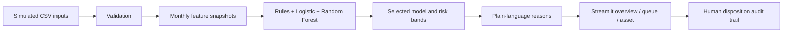

# AssetCare AI


**An explainable predictive-maintenance rapid MVP for government vehicles and assets.**

AssetCare AI turns a frozen asset-and-maintenance extract into a risk-ranked inspection queue. It validates the records, creates time-aware maintenance features, compares transparent rules with two simple machine-learning models, explains each score in plain language, and keeps the final maintenance decision with authorized staff.

> **Data notice:** every record and every metric shipped in this repository is **simulated demo data**. Nothing here is an institutional result, a live IFMIS integration, or an automated maintenance authorization.

## Why this project exists

The source blueprint defines a narrow decision gap: government assets are commonly maintained on fixed schedules even though historical maintenance and inspection records can reveal which assets need earlier attention. The rapid MVP proves one complete loop:

```text
CSV records → validation → features → score → explanation → priority → action → audit trail
```

The project deliberately favors a small, repeatable, offline-capable workflow over production infrastructure. It follows the blueprint's three-screen core—overview, queue, asset detail—and adds model evidence, data quality, and handoff guidance so the team can present the result responsibly.

## What is included

- Modern Streamlit dashboard with responsive navy, amber, and teal styling.
- Reproducible synthetic dataset with 180 assets, maintenance events, and inspections.
- Validation for schema, duplicate IDs, record linkage, event codes, plausibility, and completeness.
- Time-aware features: repair recency/frequency, repeated faults, severity, usage, cost, downtime, age, and missing-data flags.
- Weighted-rules baseline, Logistic Regression, and Random Forest comparison.
- Time-based holdout metrics: recall, precision, PR-AUC, and alert rate.
- Risk bands, three plain-language reason codes, and a recommended human action.
- Manual-review fallback for assets with insufficient maintenance and inspection history.
- Local disposition form that records the user's decision without authorizing a repair.
- CSV/Excel schema validator for candidate files.
- Automated tests, exact setup commands, demo runbook, and a generated GuideMe PDF.

## Run locally

### Fastest path on Windows

Open PowerShell in this folder and run:

```powershell
powershell -ExecutionPolicy Bypass -File .\setup.ps1
.\run.ps1
```

Open **http://localhost:8501** if the browser does not open automatically.

`setup.ps1` creates an isolated `.venv`, installs every required package, regenerates the deterministic demo data, and runs the scoring pipeline. If `uv` is installed it is used for faster, more reliable package installation; otherwise the script uses `pip`.

### Manual path

```powershell
python -m venv .venv
.\.venv\Scripts\Activate.ps1
python -m pip install -r requirements.txt
python scripts\generate_demo_data.py
python scripts\run_pipeline.py
python -m streamlit run app.py
```

### Rebuild only the artifacts

```powershell
.\.venv\Scripts\python.exe scripts\generate_demo_data.py
.\.venv\Scripts\python.exe scripts\run_pipeline.py
.\.venv\Scripts\python.exe scripts\build_guide.py
```

## Five-minute presentation flow

1. **Problem:** explain that fixed schedules do not reflect actual condition.
2. **Data:** open **Data quality** and show the frozen simulated inputs and the validation gates.
3. **Overview:** show risk distribution and the highest-priority assets.
4. **Asset:** open one Critical asset and connect its score to the three visible reasons.
5. **Action:** record an inspection request; emphasize that a person authorizes maintenance.
6. **Evidence:** compare weighted rules, Logistic Regression, and Random Forest on the time-based holdout.
7. **Close:** state that approved real data and a maintenance-SME label review are required before a pilot.

## Architecture



The application is intentionally one local process. There is no microservice, external API, database server, cloud dependency, or live-system connection.

## Model and scoring logic

The supervised target is a corrective or breakdown event within the next 60 days. Monthly feature snapshots are split by time: older snapshots train the models, while snapshots from 31 March 2026 onward form the holdout. The selected model is the strongest simple model by PR-AUC, with precision and recall used as additional controls.

The published `risk_score` is an operational ranking score from 0–100—not a calibrated probability of failure. It blends the selected model with the transparent weighted-rules score, then applies a monotonic display calibration so fixed risk bands remain useful:

- **Critical:** 80–100 — inspect within 24 hours.
- **High:** 60–79.9 — inspect within 48 hours.
- **Watch:** 35–59.9 — review within seven days.
- **Normal:** below 35 — continue scheduled maintenance.
- **Manual review:** insufficient maintenance and inspection history.

The score never authorizes repair. Reason codes are derived directly from visible features such as repair count, recent severity, high usage since service, cost, downtime, and stale inspection records.

## Data contract

The frozen demo inputs live in `data/raw/demo/`:

| File | Required fields |
| --- | --- |
| `assets.csv` | `asset_id`, `asset_class`, `make_model`, `acquisition_date`, `usage_value` |
| `maintenance_events.csv` | `event_id`, `asset_id`, `event_date`, `event_type`, `fault_or_defect`, `severity`, `maintenance_cost`, `downtime_hours` |
| `inspections.csv` | `inspection_id`, `asset_id`, `inspection_date`, `defect`, `severity`, `outcome` |

Allowed maintenance event types are `scheduled`, `corrective`, `inspection`, and `breakdown`. Uploaded candidate files are normalized to lowercase snake-case column names before schema validation.

## Project structure

```text
MINICOFIN/
├── app.py                         Streamlit application and six screens
├── assets/                        Original generated visual asset
├── data/
│   ├── raw/demo/                  Frozen simulated inputs
│   └── processed/                 Features, scores, metrics, QA evidence
├── docs/                          Status and presentation guidance
├── models/                        Saved selected model and metadata
├── output/pdf/                    Generated GuideMe PDF
├── scripts/
│   ├── generate_demo_data.py      Deterministic demo-data generator
│   ├── run_pipeline.py            Rebuild scores and model artifacts
│   └── build_guide.py             Regenerate the synchronized PDF guide
├── src/minicofin_pm/
│   ├── config.py                  Paths, bands, palette, feature contract
│   ├── data.py                    Loading, validation, uploads
│   ├── pipeline.py                Snapshot training, evaluation, publication
│   ├── scoring.py                 Features, rules, reasons, actions
│   └── ui.py                      Shared visual system
├── tests/                         Data and scoring safeguards
├── setup.ps1                      One-command setup
└── run.ps1                        One-command local launch
```

## Quality checks

Run the complete automated suite:

```powershell
.\.venv\Scripts\python.exe -m pytest
```

The suite checks blocking data gates, future-event exclusion, sparse-record detection, fixed band boundaries, explanation consistency, score bounds, sorting, and the manual-review safeguard. Final release verification also includes a clean pipeline rerun, Streamlit health check, and rendered inspection of the GuideMe PDF.

## Team ownership

| Role | Responsibility in this repository |
| --- | --- |
| Lead / PM | Scope, issue log, integration, presentation story |
| Data / ML | Data contract, validation, feature logic, model comparison |
| App / UX | Dashboard, filters, queue, detail view, disposition flow |
| Domain / QA | Event codebook, reason plausibility, action wording, release checks |

Use the fixed score-output schema as the integration contract. A proposed feature should be cut unless it improves the visible path from data to risk, explanation, or maintenance action.

## Known boundaries and next phase

This MVP does **not** include live IFMIS integration, telemetry, automated repair approval, enterprise SSO, high availability, nationwide rollout, or causal evidence of downtime/cost reduction. Those belong to a controlled institutional pilot.

The next credible step is a validation sprint with approved real data, a named data custodian, a maintenance-domain expert, a reviewed event codebook, and agreed 30/60-day labels. Only after that should the team consider integration, security hardening, monitoring, and deployment.

## Documentation

- Source blueprint: `BLUE PRINT+IMPLEMENTATION GUIDE.pdf`
- Generated operating guide: `output/pdf/GuideMe-MINECOFIN-Predictive-Maintenance.pdf`
- Current implementation status: `docs/IMPLEMENTATION_STATUS.md`
- Change history: `CHANGELOG.md`

The GuideMe PDF is generated from the current implementation facts. After material code, data-contract, run-command, or UI-flow changes, rerun `scripts/build_guide.py` and update the status/changelog in the same change.

